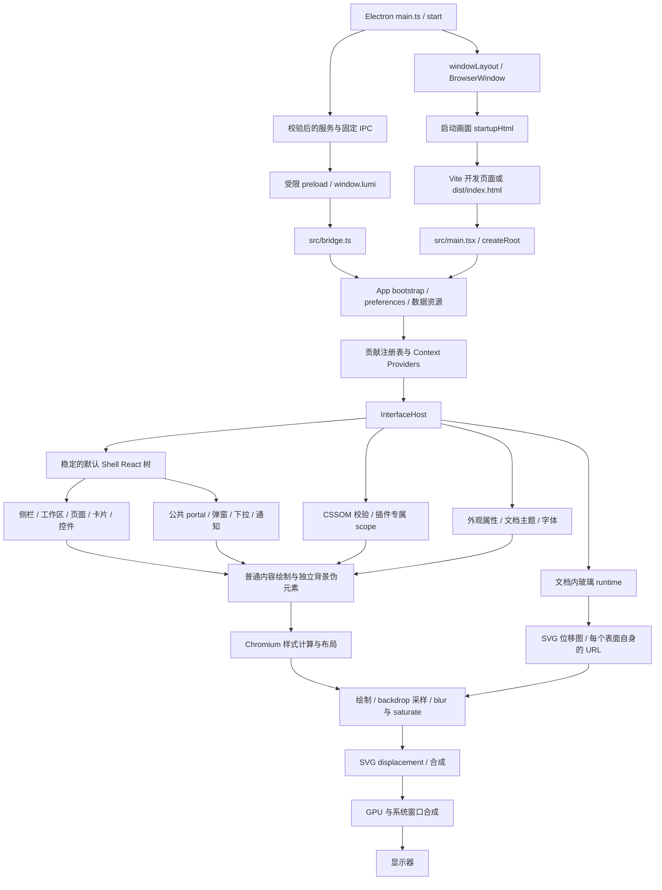
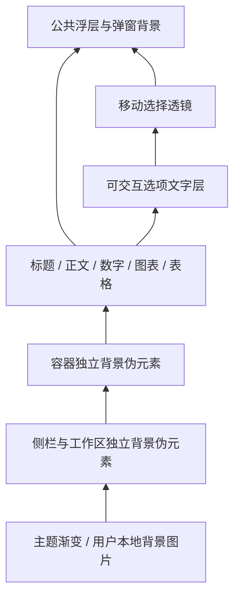
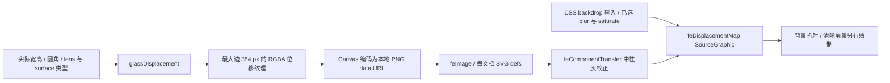
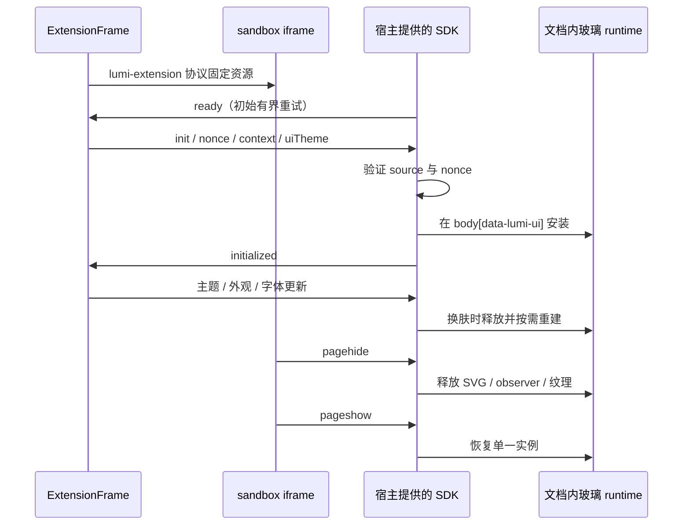

# Lumi 与浮梦的显示渲染链路

本文记录 2026-10-13 对相邻 Lumi 主程序 checkout 与独立浮梦插件的源码审计。源码链路、设计约束与本次运行结果分别说明；源码分析不能替代真实画面或 GPU 测量。相邻主程序链接使用工作区相对路径，适用于 `lumi/main` 与 `lumi/extensions` 两个独立仓库的目录布局。

浮梦是 `kind: interface` 的 CSS 界面插件，保留宿主 React 树、业务状态和受限桌面接口。插件材质来自 [interface.css](../plugins/extension.author.dreamy/interface.css)，几何折射来自宿主 [glass-refraction.ts](../../main/src/host/glass-refraction.ts)。插件包不携带 shader、宿主 SDK 或任意滤镜 URL。

## 2026-10-23：共享运行层优化

本轮优化随 Lumi 1.0.5 提供：纯位移图计算拆为独立模块，折射权重为零的像素跳过四次法线距离采样；默认布局样式表保留到宿主卸载，切换插件时只替换插件样式。旧导出与 CSS 接口保留，浮梦 1.1.10 的目录包、材质和最低宿主要求保持原样。收益需要更新宿主，重新安装同版插件不会更新宿主运行层。

Windows x64 / Node 24.18.0 下，256 组几何参数的位移图逐字节一致。应用后同进程交替测量的生成耗时中位数：工作区 6.542 → 2.982ms、模型卡片 5.139 → 3.617ms、弹窗 8.637 → 3.370ms、选中透镜 0.478 → 0.340ms。每项预热 5 次，15 组样本、每组 5 次生成。它们是 CPU 位移图生成耗时，不能代替整帧、GPU 或整机测量；正常运行仍使用已有几何与纹理缓存。

新增 `bench:dreamy-glass` 可比较指定宿主与旧运行层，默认只读源码并使用模拟几何，不启动 Electron，也不访问账户、会话或网络。以下 PowerShell 命令在插件仓库根运行；基线固定为本次优化前的完整主程序提交：

```powershell
New-Item -ItemType Directory -Force .cache/dreamy-glass-bench
git -C ../main show 5d25ca2fc9cef6e2bf993752a54f429cdd2959e5:src/host/glass-refraction.ts |
  Set-Content -Encoding utf8 .cache/dreamy-glass-bench/baseline.ts
npm.cmd run bench:dreamy-glass -- ../main --baseline-runtime .cache/dreamy-glass-bench/baseline.ts --output .cache/dreamy-glass-bench/result.json
```

可加 `--runtime <候选 glass-refraction.ts>` 比较尚未应用的实现。输出包括编译后基线与候选整体的 SHA-256、环境、样本设置、字节一致性与各项耗时，不设容易受机器差异影响的耗时门禁。

本次官方插件校验、完整软件合成 UI、硬件合成开关动画像素均通过；主程序类型检查、5 项位移图测试、4 项真实 Electron 回归、构建及隔离桌面启动检查通过。软件与硬件像素分别见 `.cache/dreamy-ui/result.json`、`result-pixels-gpu.json`；同机测量见 `.cache/theme-efficiency-20261023/applied-benchmark.json`。本节记录主题专项验证；插件目录包未变，无需单独创建插件 Release。宿主完整发行验证见相邻主程序验证记录。主程序具体拆分及验证见 [主题性能记录](../../main/docs/THEME_PERFORMANCE.md)。

## 1. 从数据到显示器



对应入口与职责：

| 阶段 | 入口 | 约束与作用 |
| --- | --- | --- |
| 桌面窗口 | [electron/main.ts](../../main/electron/main.ts)、[window-layout.ts](../../main/electron/window-layout.ts) | 先显示启动画面，再装载真实 renderer。正常运行保留硬件加速；仅 `LUMI_SMOKE=1` 显式禁用。主窗口没有浮窗的原生 acrylic/vibrancy 配置。 |
| 桌面桥接 | [preload.ts](../../main/electron/preload.ts)、[bridge.ts](../../main/src/bridge.ts) | renderer 通过固定类型接口取数；主进程校验窗口、frame、origin 与输入。浏览器预览是受限实现。 |
| 业务资源 | [App.tsx](../../main/src/App.tsx)、[dashboard.ts](../../main/src/host/dashboard.ts)、[dashboard-resource.ts](../../main/src/host/dashboard-resource.ts) | bootstrap、账户与筛选作用域、请求合并、旧结果撤回和偏好写入串行化。它们决定何时更新数据，不直接实现玻璃。 |
| 页面贡献 | [renderer-registry.ts](../../main/src/host/renderer-registry.ts)、[page-swap.tsx](../../main/src/host/page-swap.tsx) | 活动插件决定可用页面；账户绑定页面及时撤回旧内容，页面切换通过 `MotionSwap` 管理过渡。 |
| 界面宿主 | [interface.tsx](../../main/src/host/interface.tsx) | 安装默认几何布局与选中插件的 scoped CSS，应用外观属性，安装或释放玻璃 runtime，同步数值配色。 |
| 窗口结构 | [Shell.tsx](../../main/plugins/interface.default/renderer/Shell.tsx) | 标题栏、背景、侧栏、工作区与公共浮层始终由宿主维护；换肤不替换整棵 React 树。 |
| 显示管线 | Chromium / Electron | CSS 和 SVG 交给浏览器绘制与合成。CPU 渲染耗时、GPU 合成耗时、显存及最终占用率是不同指标。 |

`App` 对页面内容、Context 值和贡献列表使用 memo。搜索输入、通知等外壳状态变化不应重绘不相关业务页；账户数据变化仍应让相关内容更新。统计、图表汇总和请求合并的优化需要独立验证，不能由此推断 backdrop 的 GPU 成本。

## 2. CSS 加载与覆盖顺序

[src/main.tsx](../../main/src/main.tsx) 的静态导入顺序如下。这里的“层”表示加载与覆盖顺序，不表示这些文件都声明了 CSS `@layer`。

1. `components/segmented-switch.css`
2. `styles.css`
3. `workbench.css`
4. `select.css`
5. `theme-tokens.css`
6. `theme.css`
7. `updates-trends.css`
8. `filters-tools-motion.css`
9. `platform-logs.css`
10. `host/extension-layout.css`

页面与组件还会按模块加载自己的 CSS，例如模型市场、插件市场、背景和设置相关样式。不能把上述静态列表当作整个页面的唯一 CSS 来源。

`InterfaceHost` 使用 `document.adoptedStyleSheets` 安装 [defaultInterfaceLayout](../../main/plugins/interface.default/layout.ts)，随后安装所选界面插件的样式表。最终优先级同时受 CSS specificity、scope proximity、`!important`、内联样式和浏览器动画影响，不能单凭文件先后判断。`extension-layout.css` 对插件详情 modal 的 `!important` 规则是需要特别核对的宿主覆盖。

浮梦根节点是 `.desktop-shell[data-interface="extension.author.dreamy"]`。宿主在它上面维护 `data-theme`、`data-appearance-transparency`、`data-appearance-blur` 和 `data-appearance-distortion` 等属性。插件通过这些属性选取材质变量，不另建全局主题状态。

## 3. 插件 CSS 的安全边界

[scopedInterfaceSheet](../../main/src/host/interface.tsx) 先用 CSSOM 解析并检查，再把规则放入插件专属的 `@scope`：

- ID 必须符合界面扩展格式，CSS 大小不超过 65,536 字符，规则数不超过 1,000。
- 支持样式、`@media` 和 `@supports`；不接受任意其他 at-rule。
- 解析前识别并拒绝 `@import`；属性中禁止 `url()`、`image-set()`、窗口拖动属性及越界的 `z-index`。
- 外部界面插件只能改变允许范围内的布局与皮肤，不执行外部脚本或替换宿主组件。
- SVG 位移资源由宿主生成，插件只消费 `var(--lumi-glass-filter, blur(0px))`，不能自行附加任意 SVG URL。

因此，CSS 里出现滤镜变量不代表宿主已为该节点注册几何，也不代表插件可以自己补一个 SVG 定义。新增宿主组件可按公开约定声明 `data-lumi-glass`；纯界面 CSS 不能给既有 DOM 添加该属性。

## 4. 主窗口的玻璃层级



| 表面 | 浮梦实现 | 折射与清晰度 |
| --- | --- | --- |
| 桌面背景 | 根节点渐变，或 `UserBackgroundLayer` 本地图片 | 作为玻璃采样来源；不把整页正文交给 `filter`。 |
| 侧栏 | `.sidebar::before` | 本体保持普通层叠上下文，伪元素消费本体自身的几何引用。 |
| 工作区 | `.content-scroll::before` | 背景锚定可见工作区，几何从实际伪元素尺寸取值，避免随长内容滚动使用错误映射。 |
| 卡片与面板 | 容器 `z-index:0`，`::before` 在 `-1` | 背景底色、blur、边缘折射独立；前景文字普通绘制。 |
| 连续选择控件 | `SegmentedSwitch` 按钮文字在 `1`，`.segmented-thumb` 在 `2` | 移动透镜采样实际文字，保留中心放大，不额外模糊标签。 |
| 普通选中模型 | `.model-choice.selected` | 使用平直中心的背景折射，不使用文字放大向量。 |
| modal、popover、toast、tooltip、picker | 公共宿主浮层，皮肤提供材质 | 每个目标拥有自己的映射；退出时保留必要画面，生命周期结束后释放。 |

伪元素背景用于避免容器本体的 backdrop-filter 截断内部透镜的采样。也要避免在过滤层祖先上加入 `opacity < 1`、`filter` 或其他新的 backdrop root。遮罩淡出与模糊动画放在同一个背景伪元素上，遮罩父容器保持 `opacity:1`；减少动态效果时由对应媒体规则撤回动画。

这里描述的是源码层级关系。浏览器最终是否独立提升合成层、如何分配离屏 surface，需要运行时证据；CSS 中的一个伪元素不等于一个独立 GPU layer。

## 5. 宿主折射 runtime

[installGlassRefraction](../../main/src/host/glass-refraction.ts) 在每个文档自己的玻璃根节点上安装，使用 `WeakMap` 防止同根重复安装。它不捕获屏幕、不读取用户页面截图，也不向网络请求纹理。

### 目标注册与可见性

兼容目标包含侧栏、连续滑块、已选供应商/收藏/模型、公共浮层、原生 picker，以及工作区和若干容器类。普通容器还需皮肤声明 `--lumi-glass-surface:1`。新增 DOM 元素可明确声明：

| 声明 | 用途 |
| --- | --- |
| `data-lumi-glass="background"` | 独立背景伪元素，几何取背景绘制区域。 |
| `data-lumi-glass="surface"` | 宽边缘容器折射。 |
| `data-lumi-glass="lens"` | 中心放大的选择透镜。 |

候选需有可见布局盒、可见 visibility，并与视口及滚动祖先裁剪范围相交。永久零 opacity 排除；有限 opacity 进入动画可在本体或祖先零透明度时预注册，避免可见中间帧漏掉折射。普通候选还需本体或 `::before` 使用 backdrop-filter；显式声明与 picker 有独立处理。当前检测不覆盖仅在 `::after` 使用 backdrop-filter 的普通表面。

运行时保留最多 96 个 live filter，优先级为 popup、lens/picker、侧栏/工作区、普通容器。同级使用当前候选顺序。此上限用于约束资源，不能为保证“每个场景都有扭曲”而直接无限提高；拥挤页面需要验证实际目标是否被预算裁去。

运行时安装弱作用域规则，为后代逐个重置 `--lumi-glass-filter:blur(0px)`，仅在已注册节点上写入本地 URL。该节点的伪元素仍继承它自己的引用，子组件不会误用父组件的尺寸映射。

### 几何与滤镜



- 普通表面中心保持平直，圆角边缘生成方向性位移；透镜额外加入中心放大向量。
- 位移纹理最大边为 384 像素，按逻辑宽高映射回实际表面。纹理缓存上限与 backdrop 实际离屏绘制面积是不同约束。
- 纹理 key 包含取整宽高、圆角、lens/surface 类型；等几何复用最多 32 项 LRU 缓存。
- 扭曲强度限制在 `0..12`。普通表面的 SVG scale 为强度的 2 倍，宽边缘 surface 为 4 倍；强度变更不重做纹理。
- 透明度实色、系统减少透明度、强制颜色或零强度会释放滤镜。减少动态效果主要撤回动画，并不等同于关闭静态折射。
- CSS blur 与 SVG 的组合需保持真实模糊生效，相关回归直接比较消息背景像素，避免 SVG 输入绕过已有 blur。

### 更新与释放

更新来源包括 subtree 的 class/style/显示属性变更、head 样式变更、`ResizeObserver`、点击/键盘/输入/滚动、动画与过渡边界、窗口 resize 和辅助显示模式变化。所有来源合并到下一次 RAF，没有常驻动画循环。

运行时识别自身 `--lumi-glass-filter` 写入，避免这种写入递归触发扫描。本轮将批次内读取与写入分开，滚动复用候选与有效几何，样式、DOM、声明及 ResizeObserver 使缓存失效；有限进入动画监听 finish/cancel，不依赖超时轮询。卸载、换肤或表面退出时恢复原内联变量，删除 SVG 定义，断开 observer，取消待执行帧并释放纹理。

连续滑块拖动、tooltip 移动会改变 style，因而可能触发候选扫描。扫描中仍有 style、bounds、祖先裁剪与排序工作；是否形成明显 CPU 瓶颈必须测量，不能仅凭事件数量判定。即使扫描成本降低，也不能直接作为 GPU 降幅。

## 6. 功能插件 iframe 与 SDK



[ExtensionFrame](../../main/src/host/extension-frame.tsx) 使用 `sandbox="allow-scripts"`，不授予同源权限；插件脚本不能访问主窗口 DOM、preload 或凭据。资源经 `lumi-extension` 协议按扫描代次提供，CSP 禁止直接网络、嵌套 frame、worker 和对象资源。SDK 的受控消息桥接另行校验来源、nonce、方法与大小。

选择宿主 UI 的文档通过 `link[data-lumi-ui]` 接收主题。主窗口和 iframe 使用同一份折射算法，但各有自己的 SVG、几何、视口和生命周期；iframe 中的普通 backdrop 采样不能被假定为可以穿透文档边界读取主窗口的任意内容。

[scripts/extension-ui.mjs](../../main/scripts/extension-ui.mjs) 以以下顺序生成共享 UI CSS：`theme-tokens.css`、`styles.css`、`workbench.css`、`select.css`、`theme.css`、`filters-tools-motion.css`、`platform-logs.css`、`components/segmented-switch.css`、`host/extension-ui.css`。SDK 再将选中界面 CSS 包装进 `@scope (body[data-lumi-ui])`。该列表与主窗口入口并不相同。

实际供给文件是构建输出 `dist-electron/lumi-extension-sdk.js`，由算法 bundle 与 [public/lumi-extension-sdk.js](../../main/public/lumi-extension-sdk.js) 合并。插件不得复制或打包宿主 SDK。设置页 iframe 另有避免重复背景过滤的规则，应同时核对外层插件详情 modal 与内层内容清晰度。

## 7. 原生浮窗和托盘是另一条链路

[WidgetPanel](../../main/electron/services/widget-panel.ts) 与 [TrayPanel](../../main/electron/services/tray-panel.ts) 是独立 BrowserWindow，使用各自受限 preload、`widget.html`/`tray.html`、React 入口和 CSS。主窗口通过 [syncSurfaceTheme](../../main/src/host/surface-theme.ts) 把 Chromium 解析后的语义颜色转换为数值 palette，校验后送入这些表面；它们不直接接收完整 Dream CSS。

| 平台/表面 | 材质链路 | 与 Dream 的关系 |
| --- | --- | --- |
| Windows 支持的系统 | [surface-backdrop.ts](../../main/electron/services/surface-backdrop.ts) 的原生 acrylic；不支持时透明窗口回退 | 接收配色与格式化快照，不走 Dream 主窗口 SVG 目标注册。 |
| macOS 浮窗 | [mac-widget-material.ts](../../main/electron/services/mac-widget-material.ts) 与原生模块；支持时 `NSGlassEffectView`，否则 HUD vibrancy，减少透明度时不透明回退 | 系统材质与 DOM 折射不同，Windows 检查不能证明 macOS 原生显示。 |
| macOS 菜单栏 | Swift/AppKit helper 与受限快照/动作 | 不读取账户凭据，不通过主窗口 CSS 显示。 |
| renderer 内容 | `src/widget.tsx` / `src/tray.tsx` 各自组件与状态 | 独立于主 AppContext；主界面换肤与数据更新需保留其生命周期。 |

这些窗口显式使用 `backgroundThrottling:false`，隐藏时可能保留 renderer；插件停用或关闭服务会释放资源。该配置是否影响总空闲占用需单独测量，不能把进程总 GPU 变化全部归因于 Dream 主窗口。

## 8. 缺失效果、设计范围与待验证风险

| 场景 | 源码结论 | 判断边界 |
| --- | --- | --- |
| 外观缩略预览 | 原实现无脚本、无玻璃 runtime。本轮 [appearance-preview.tsx](../../main/src/host/appearance-preview.tsx) 在独立不透明源文档运行固定 SHA-256 授权的宿主 runtime，支持本地位移 PNG | 插件静态模板仍经白名单净化；不授予同源、IPC、网络或任意脚本。生产父 CSP 与子 CSP 同时授权准确的宿主脚本字节；专项真实像素回归验证。 |
| 从 `opacity:0` 进入的玻璃表面 | 本次暂停真实 CSS 进入动画，分别推进到 10%、50%、90%；旧 runtime 各帧均没有自己的折射引用，直到结束才补上。本轮有限进入预注册补回效果 | 暂停、延迟、祖先动画与取消/释放已有正式回归；方案与同机诊断见第 12 节。零透明度本身不可见，不将该帧没有 URL 单独判为缺陷。 |
| 普通容器平直中心 | 位移算法故意只弯曲边缘；lens 才增加中心放大 | 不能把平直中心直接判为滤镜失效。需要选择有真实背景特征的边缘区域比较。 |
| 强 blur / 平滑底色 | 背景细节可能已被模糊，位移视觉差异可能很小 | URL 存在与视觉明显程度都不足以单独证明正确或错误。 |
| 未注册新节点 | 固定兼容 TARGETS 或显式 `data-lumi-glass` 才获得映射；普通容器有额外 opt-in | 需对照实际 DOM、有效 backdrop 与注册条件。不能为表面补一个祖先 URL 掩盖几何错误。 |
| legacy tabs 选择器差异 | Dream CSS 保留多个历史 class，当前主程序对应控件已广泛采用 `SegmentedSwitch` | 不能只比较 CSS selector 与 TARGETS 列表就报 bug；实际折射通常由统一 `.segmented-thumb` 提供。 |
| 拥挤页面 | 96 个过滤器预算及优先级确实存在 | 是否有可见目标被裁去、是否影响要求场景，需要运行时统计和截图。 |
| 仅 `::after` 过滤 | 普通候选有效性当前只检查本体及 `::before` | 属于宿主能力边界；尚不能据此断言当前 Dream 存在对应缺陷。 |
| 插件详情 modal 进退 | `extension-layout.css` 把玻璃放到 `::before`，宿主 modal 动画仍可能让本体 opacity 小于 1 | 有形成 backdrop root 的结构风险；必须采集进退中间帧，不能用最终静态截图直接确认缺陷。可先验证插件侧分层修复。 |
| 系统辅助显示/实色 | runtime 释放扭曲，皮肤关闭或替换玻璃材质 | 属于预期回退，须验证恢复后不遗留失效引用。 |

本次普通工作区、嵌套滚动、普通弹窗与弹窗滚动、多选浮层、原生下拉稳态检查没有发现漏注册。已确认并修复的两处缺失为进入动画的注册时机与缩略预览未安装 runtime；其它能力边界仍需按实际场景验证。

需要主程序修改时，先说明必要性、具体方案、范围与兼容影响，等待用户明确决定。插件开发请求本身不授权修改主程序。优先在当前公开接口和插件 CSS 内完成可行修复。

## 9. 效率优化应比较什么

| 工作 | 可以证明 | 不能自动证明 |
| --- | --- | --- |
| 请求合并、统计缓存、减少 React render | IPC/网络/CPU 工作量或响应耗时下降 | backdrop GPU 占用下降。 |
| 共享位移 PNG、避免强度变化重新编码 | CPU 编码与纹理生成次数下降 | 实际过滤区域、blur 合成成本或显存同比下降。 |
| 删除确认无消费者的滤镜定义 | 无效资源分配减少 | 用户可见的效果一定不变，仍需画面比较。 |
| 减少重复/被遮挡的 backdrop 过滤 | 减少潜在绘制或离屏工作 | 视觉必然等价；backdrop root、blur 顺序和边缘可能改变。 |
| 降低 blur、强度、分辨率、目标数或帧率 | 通常减少某些工作量 | 满足“效果不变”。不能用降级替代等价优化。 |
| 关闭硬件加速 | 改变合成后端，便于部分确定性回归 | 优化实际用户 GPU 使用；可能把成本移到 CPU。 |
| 增加 `will-change` / transform / containment | 改变层与裁剪策略 | 一定更快；可能增加离屏 surface、显存或破坏采样。 |
| 候选扫描缓存/事件精简 | 如经测量，可降低 JS 样式与布局工作 | 实际 GPU 降幅，且仍需保留可见性与生命周期正确性。 |

真实 GPU 比较需固定同一硬件、Electron、窗口尺寸、DPR、主题、blur/透明度/强度、场景和操作节奏，分别记录空闲、滚动、透镜拖动、tooltip 跟随、弹窗进退及 iframe 流式内容。记录合成后端与窗口可见状态；软件离屏结果不能代替硬件占用结论。变化的显存、GPU 时间、帧耗时与 Windows 任务管理器占用率也不能互相替代。

## 10. 验证链路与证据边界

| 验证入口 | 覆盖 | 不覆盖/注意事项 |
| --- | --- | --- |
| [benchmark-rendering.mjs](../../main/scripts/benchmark-rendering.mjs) / `bench:render` | 固定模拟用量点的 `groupedTrend` CPU 汇总 | 不测 DOM、blur、SVG、合成或 GPU。 |
| [renderer-pipeline-ui.test.ts](../../main/tests/renderer-pipeline-ui.test.ts) | chrome 更新不重绘业务 probe、无关偏好不重复主题 IPC、实际主题只同步一次、并发 dashboard 读合并 | 不证明扭曲像素或 GPU 降幅。 |
| [glass-refraction.test.ts](../../main/tests/glass-refraction.test.ts) | 位移图几何、方向、中性中心等算法约束 | 单元数据不等于最终画面。 |
| [glass-refraction-ui.test.ts](../../main/tests/glass-refraction-ui.test.ts) | 显式目标、可见性、预算优先级、纹理复用、空闲帧、样式刷新、辅助显示与释放 | 默认软件合成，主要证明 runtime 生命周期。 |
| [extension-refraction-ui.test.ts](../../main/tests/extension-refraction-ui.test.ts) | opaque iframe、实际 CSP、消息背景像素、前景清晰、blur/SVG 组合、换肤/隐藏/page 生命周期及早/晚 SDK 加载 | `LUMI_GLASS_HARDWARE=1` 可启用硬件；画面正确不等同于测得 GPU 降幅。 |
| [appearance-preview-ui.test.ts](../../main/tests/appearance-preview-ui.test.ts) | 精确生产父/子 CSP、浅深缩略预览关闭/轻微/明显像素、去脚本负对照、权限隔离、pagehide/pageshow、离屏拆卸、实色释放 | `LUMI_GLASS_HARDWARE=1` 启用硬件；条纹夹具证明算法链路，实际外观仍由完整 Dream 回归覆盖。 |
| [extension-settings-glass-ui.test.ts](../../main/tests/extension-settings-glass-ui.test.ts) | 外层与 iframe 内前景清晰度 | 最终画面不能代替特殊 modal 的进退中间帧。 |
| [check-dreamy-ui.mjs](../scripts/check-dreamy-ui.mjs) 及对应市场/控件/设置检查 | 匹配主程序 checkout 的真实插件界面 | 以本次实际执行命令和结果为准；包校验不能替代 UI 回归。 |
| `npm.cmd run check` | 官方固定宿主包结构/权限/资源校验 | 不证明当前主程序源码、已安装应用或 GPU 行为一致。 |

在独立插件仓库运行真实 UI 检查时应明确主程序路径，例如 `npm.cmd run check:dreamy-ui -- ..\main`。`--pixels-only` 与 `--hardware` 的覆盖范围不同，报告中保留完整参数；其它专项脚本以自身参数定义为准。测试使用隔离 fixture 和假数据，不接触真实账户、CLI 配置或付费请求。

“效果不变”需同时覆盖浅/深主题、相关外观档位、实际业务背景、正文清晰度、弹窗开启/关闭中间帧、退出生命周期、焦点/拖动/键盘行为、隐藏恢复与辅助显示回退。仅计算 CSS 属性插值、定义存在、合成层数变化或注入条纹的截图都不能代替完整视觉证据。

## 11. 本次实测记录

本次使用隔离模拟数据。以下性能对照记录的是当时准确的 CSS/runtime 散列；正式合入后另执行主程序回归与构建。未进行发布，不把历史公开验收或其它平台结果当作本轮验证。

| 环境/版本 | 本次值 |
| --- | --- |
| 日期、系统、GPU、驱动 | 2026-10-13；Windows x64 10.0.28000；NVIDIA GeForce RTX 5080；驱动 32.0.16.1692 |
| 主程序版本、提交与工作树差异 | Lumi 1.0.3，基准提交 `f382232fc51744cbd7ec597e7f73cfd34c97420c`；本轮修改玻璃调度与预览，版本未发布升级；本地 `AGENTS.md` 保留 |
| Dream 版本、提交与工作树差异 | 基线 1.1.9，提交 `b9c034be878579897152a8cb890c84a02dbc1e1c`；本轮开发版本 1.1.10，仅优化实色浮层滤镜并增加诊断、文档；尚未提交或发布 |
| Node、npm、Electron、Chromium | 24.18.0 / 11.16.0 / 44.5.0 / 152.0.7977.130 |
| 性能窗口与后端 | CSS viewport 1320×982、DPR 1.5；可见且未最小化、非 offscreen；完整 GPUInfo 确认 ANGLE D3D11 / GaneshGL，独立 GPU 进程、硬件 compositing/rasterization enabled |
| 场景与设置 | 浅／深主题；普通场景通透+轻柔+明显；实色 GPU 场景为固定多选浮层、背景多个容器滚动；每工作负载 6000ms |
| 视觉门禁 | 浅／深主题 × 8 种浮层；普通/插件详情弹窗包含开启和关闭中间帧；不透明+强烈模糊+明显扭曲；目标外 100 逻辑 px 覆盖完整投影 |
| 基线与当前 CSS SHA-256 | `87094ba18aa784392312ff129eac07276b3357f0708393c409a07ed366960e07` → `3a6821e3b5796ef5abc020c16d96ffdf6fe335c13e299c2688248595dd8dd450` |

| 检查/场景 | 命令与参数 | 结果/指标 | 日志、截图或 trace |
| --- | --- | --- | --- |
| 官方插件包校验 | `npm.cmd run check` | 5 个插件通过，Dream 1.1.10 | `.cache/dreamy-render-optimization-check.log` |
| 原实现完整硬件 UI 基线 | `npm.cmd run check:dreamy-ui -- ..\main --baseline --hardware` | 浅深、逐帧模糊、进退、焦点/菜单、窄窗、辅助显示通过；只回退插件 CSS | `.cache/dreamy-ui-baseline/result.json` |
| 实色浮层严格硬件像素 | `npm.cmd run check:dreamy-solid-ui -- ..\main --hardware --baseline-ref b9c034be878579897152a8cb890c84a02dbc1e1c` | 36 场景通过；正文/内部/完整投影 RGBA 逐字节一致；2px 圆角边界最大通道差 25，明显差异占实际目标面积最多 0.497% | `.cache/dreamy-solid-final-shadow-gpu.log`、`.cache/dreamy-solid-ui/result-gpu.json` 与 baseline/candidate/diff PNG |
| 宿主调度备选契约 | `.cache/glass-refraction-proposal-contract.test.ts` | 16 组软件契约通过，0 失败；已迁入主程序正式回归 | `.cache/glass-refraction-proposal-contract.log` |
| 备选宿主真实硬件画面 | `check:dreamy-rendering`，`--baseline --hardware --runtime .cache/glass-refraction-proposal.ts --fail-on-missing` | 14 个正常稳态截图与原 runtime 逐像素相同；12 项关闭/明显扭曲像素对照均非零；进入动画中间帧补回原本缺失的折射 | `.cache/dreamy-rendering-proposal-gpu/result.json` 与 trace/PNG |
| 实色浮层 GPU 对照 | `check:dreamy-rendering`，两次相同 `--hardware --solid-only --duration-ms 6000`，CSS 基线与当前分别运行 | 同 probe/runtime、viewport、DPR、显示状态；各主题 5 个有效目标 GPU 进程样本 | `.cache/dreamy-rendering-solid-{baseline,current}-fixed-gpu/result.json` |
| tooltip 跟随 / iframe 流式性能 | 本轮未测 | 不外推已测滚动、选择切换结果 | — |
| GPU 硬件时间 / 显存 | 本轮未测 | trace GPU/Viz task 只报告 CPU 提交/调度时间；不按滤镜数估显存 | 每结果 `limitations`、`traceSummary` |

实色浮层的改动保留 `blur(0px)`，而非 `none`，因为移除 backdrop root 的早期方案会改变特殊插件详情弹窗的正文合成。最终画面接受范围明确限定在圆角抗锯齿边界；并不宣称整个 framebuffer 每个字节都相同。完整投影外区累计检查 5,764,844 个像素，全无 RGBA 差异。

实色固定多选浮层后方连续滚动的同机 GPU 3D 引擎均值，浅色 **1.0682% → 0.9747%**、深色 **1.1120% → 0.9562%**，分别下降 0.0935 / 0.1557 个百分点；每主题旧/新各 5 个有效样本、约 362 帧，P95 16.8ms。只能说明本机这两个 6 秒观测的小幅变化，不承诺全界面或所有设备相同降幅。不同物理引擎不相加；GPU 进程 CPU 百分比与这些硬件 counter 分开报告。

曾运行隐藏窗口，观察到 rAF 约 1Hz，结果保留在 `.cache/dreamy-rendering-baseline-hidden-gpu` 并排除性能比较。两次正式实色对照固定截图前的滚动位置；不会将帧末正弦相位差造成的背景变动当作材质变化。

## 12. 宿主调度修复与效率结果

用户已明确授权玻璃调度、资源复用及外观缩略预览的真实折射。本轮正式改动以主程序 Git diff 为准，审阅阶段的 `.cache/glass-refraction-proposal.patch` 仅保留为备选过程证据。核心方案：

1. 有限 opacity 进入动画提前分配自身滤镜；支持暂停、延迟和祖先入场，永久透明、无限动画与退出终态保持排除。
2. 仅监听这些 Animation 的 finish/cancel，取消、停用与卸载释放监听；不增加常驻 RAF 或超时轮询。
3. 一批 DOM 读取完成后再写 SVG/样式；复用本批祖先 opacity 和 overflow clip。
4. 滚动复用候选与未变化几何，保持实时视口/裁剪检查；DOM/class/声明、样式、ResizeObserver 和伪元素尺寸变化使缓存失效。

位移函数、384px 纹理上限、32 项 LRU、96 个资源预算与优先级、SVG 顺序、blur 和强度保持。没有增加插件权限或 IPC，也没有关闭硬件加速。有限暂停进入可能暂占资源预算，直到取消、结束、隐藏或关闭折射；这项生命周期约束有独立回归。

使用原版 CSS 比较旧 runtime（散列 `54dedc1e…`）与备选 runtime（`ff9884db…`），每场景 6 秒的诊断如下：

| 场景 | 原 ScriptDuration | 新 ScriptDuration | 原 `Document::UpdateStyleAndLayout` 次数 | 新次数 |
| --- | --- | --- | --- | --- |
| 浅色滚动 | 1.2201s | 0.5031s | 202826 | 72794 |
| 深色滚动 | 1.1884s | 0.5052s | 202811 | 73044 |
| 浅色选择切换 | 0.8121s | 0.5245s | 108259 | 48787 |
| 深色选择切换 | 0.7917s | 0.5165s | 108259 | 48785 |

这些结果主要证明 JS 与重复读取工作减少。原/备选 clear 场景 GPU 3D 滚动约 5%、切换约 4.2%，没有明确下降；不能将约 58% 的脚本耗时下降当作 GPU 降幅。帧数 361–362、P95 约 16.8ms。完整基线与备选运行之间诊断脚本增加了 counter 元数据与实色场景，clear 操作与运行条件已人工核对；这组结果是诊断证据，未作为性能统计门禁。

`check:dreamy-rendering --compare` 报告原始像素差供审阅，不自动判视觉通过；`--fail-on-missing` 仅在实际可见的中间帧缺少折射时失败。严格画面门禁来自 `check:dreamy-solid-ui` 的区域 RGBA 断言与主程序正式预览/iframe 回归。基线可用 `--baseline-ref <完整提交>` 固定，结果同时记录 CSS、runtime、probe 散列、viewport、DPR、显示与节流有效性。

## 13. 最终实现与回归

正式主程序 runtime 已包含上述调度修复；位移图、模糊和强度接口保持。外观预览在 opaque iframe 中复用宿主算法，父 CSP 与子 CSP 仅放行构建时计算的固定 SHA-256 脚本；每份外观快照创建独立文档，离屏卸载，`pagehide/pageshow` 清理和恢复。插件模板没有获得脚本或同源权限。

实际生产构建的预览脚本为 10582 字节，SHA-256 base64 为 `GOpb2dDMreVUFBtk8YSFhkl4qlzGexXq+NIQJb4LHWc=`；父 `dist/index.html` 与 JS 内的脚本散列一致。真正供给的 `dist-electron/lumi-extension-sdk.js` 与当前源码重新 bundle 逐字节一致，包含候选与几何缓存、有限进入监听；不包含预览模块。开发监听也覆盖 Windows 路径规范化。

| 最终检查 | 结果 | 证据 |
| --- | --- | --- |
| 主程序 typecheck、内置插件校验、生产 build | 通过；保留 65 份 npm 与 84 份 Rust 完整许可 | `../main/.test-data/dreamy-render-final-{typecheck,host-extensions,build}.log` |
| 主程序完整 `npm.cmd test` | 921 项，918 通过、3 项平台跳过、0 失败 | `../main/.test-data/dreamy-render-final-test.log` |
| 真实预览软件/硬件 | 两主题关闭→轻微→明显均有真实像素差；剥掉宿主脚本后不同强度没有超过 3 通道值的像素差，仍与启用折射时不同；CSP、父/Node/API 隔离及清理恢复通过 | 软件见完整测试；硬件 `../main/.test-data/dreamy-render-final-preview-hardware.log` |
| Dream 当前完整硬件 UI | 浅深模糊逐帧、进退、焦点、菜单、窄窗、辅助显示回退通过 | `.cache/dreamy-render-final-ui.log`、`.cache/dreamy-ui/result.json` |
| Dream 市场真实软件/硬件 | 各 8 场景通过，前景清晰度最小比值分别 0.9426 / 0.9544，门限仍为 0.8 | `.cache/dreamy-render-final-market{,-hardware}.log`、`.cache/dreamy-market-ui/result-{software,gpu}.json` |
| 独立插件官方校验、脚本语法、差异格式 | 5 个插件及新脚本通过 | `.cache/dreamy-render-final-check.log` |
| 构建后的隔离桌面启动 | 全部检查通过；预览可见性检查保留原草稿、焦点和滚动断言，检查完成后恢复并再次验证 | `../main/.test-data/dreamy-render-final-desktop.log` |

市场测量使用文字 Range 裁剪、有字/仅撤文字颜色的同背景画面差分，避免穿透背景的边缘增加参考值而误报前景模糊。每对比较固定字体、样式、几何、viewport、DPR 和滚动。预览回归等待 opaque srcdoc 导航完成；初始 about:blank 不作为隔离状态的最终结论。

上述实现阶段尚未创建安装包、提交、推送或公开 Release，当时主程序为 1.0.3 开发工作树，Dream 为 1.1.10 开发工作树；该阶段没有 macOS/Linux 运行证据。后续 2026-10-14 发布验证、版本与公开状态见 [发布验收记录](RELEASE_VALIDATION_2026-10-14.md)，不将历史研究结果冒充发布检查。
